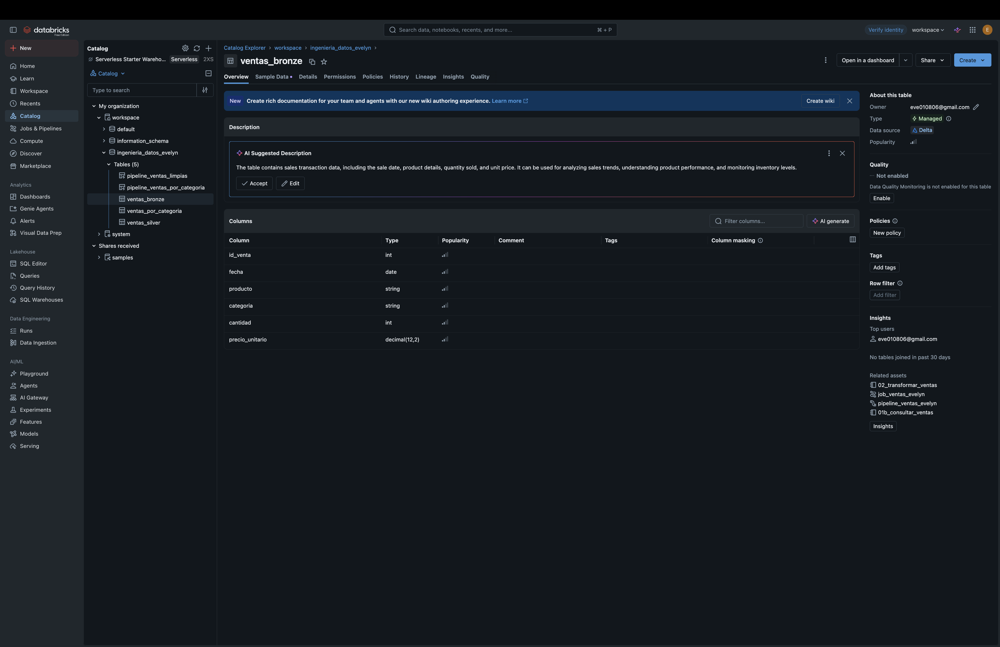
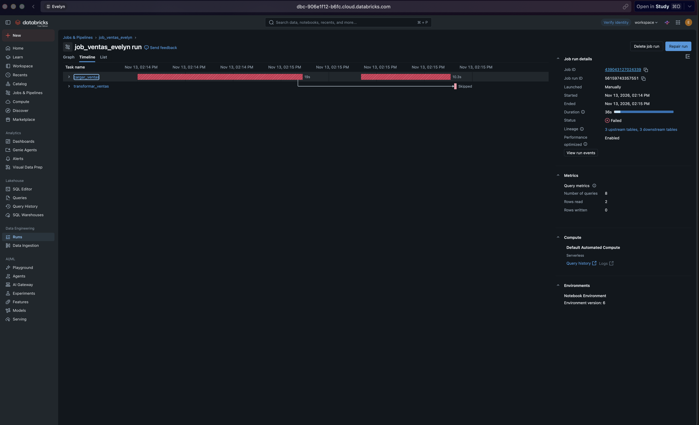
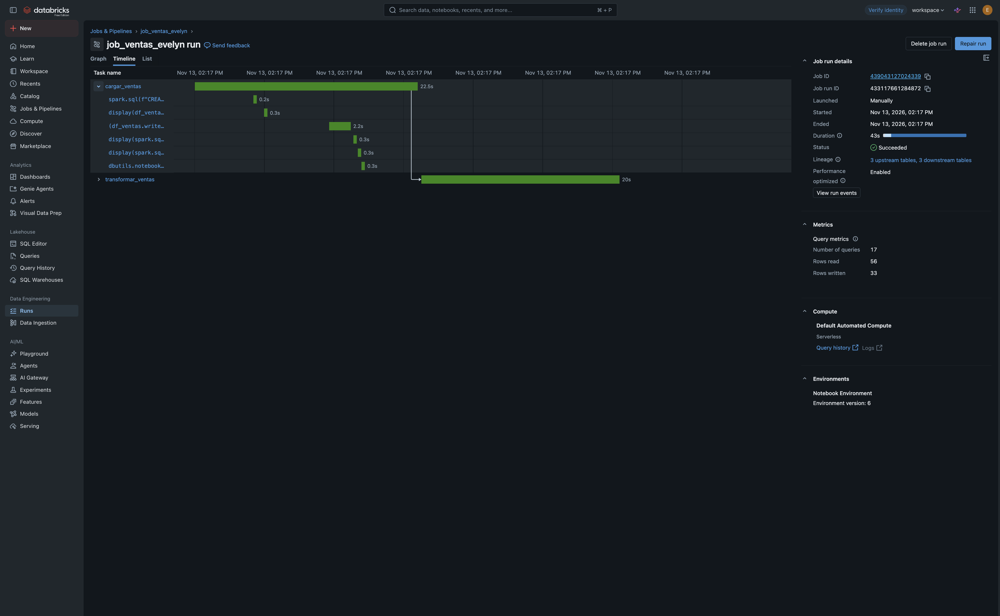
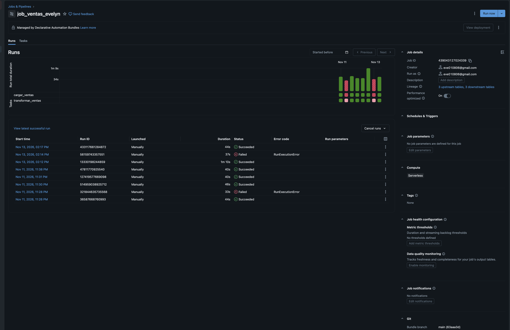
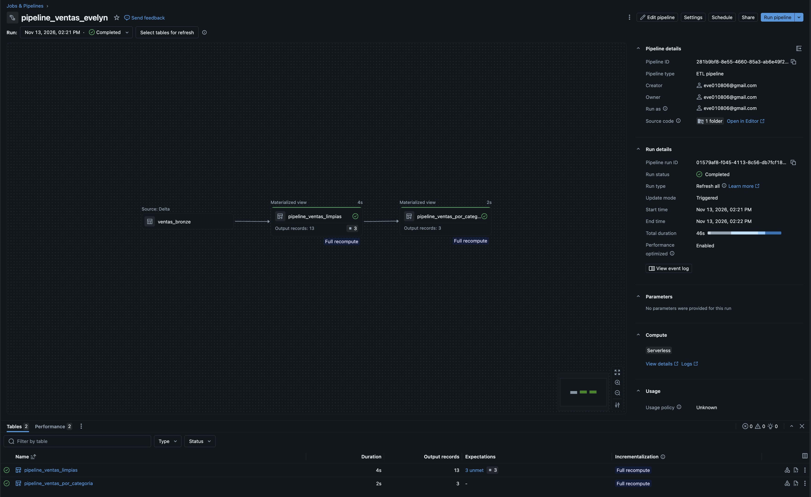

# Taller Databricks Activity 1

**Ingeniería de Datos, Universidad EIA, 2026-2**
**Evelyn Gómez Aristizábal**

Una tienda necesita almacenar sus ventas, corregir errores y automatizar la preparación de sus reportes. Este repositorio contiene el código, la configuración y la evidencia de los cuatro ejercicios, ejecutados en Databricks Free Edition con cómputo serverless.

| Elemento | Valor |
| --- | --- |
| Catálogo | `workspace` |
| Esquema | `ingenieria_datos_evelyn` |
| Job | `job_ventas_evelyn` |
| Pipeline | `pipeline_ventas_evelyn` |

Todo el proyecto se desplegó y ejecutó desde la terminal con el Databricks CLI y un bundle (Declarative Automation Bundles). Los notebooks quedan en el workspace en `/Workspace/Users/<usuario>/.bundle/taller_databricks/dev/files/src/`. Cada ejecución guardó su salida en `evidencias/`, y las capturas de la interfaz están en `capturas/`.

## Contenido

1. [Estructura del repositorio](#estructura-del-repositorio)
2. [Dataset](#dataset)
3. [Ejercicio 1. Almacenar y consultar datos en el catálogo](#ejercicio-1-almacenar-y-consultar-datos-en-el-catálogo)
4. [Ejercicio 2. Transformar datos y aplicar reglas de calidad](#ejercicio-2-transformar-datos-y-aplicar-reglas-de-calidad)
5. [Ejercicio 3. Automatizar el proceso mediante un job](#ejercicio-3-automatizar-el-proceso-mediante-un-job)
6. [Ejercicio 4. Construir un pipeline declarativo](#ejercicio-4-construir-un-pipeline-declarativo)
7. [Decisiones técnicas](#decisiones-técnicas)
8. [Cómo reproducir](#cómo-reproducir)
9. [Fuentes](#fuentes)

## Estructura del repositorio

```
taller_databricks/
├── databricks.yml                      configuración del bundle
├── resources/
│   ├── job_ventas.yml                  job del ejercicio 3
│   └── pipeline_ventas.yml             pipeline del ejercicio 4
├── src/
│   ├── 01_cargar_ventas.py             ejercicio 1, crea ventas_bronze
│   ├── 01b_consultar_ventas.py         ejercicio 1, lectura desde otro notebook
│   ├── 02_transformar_ventas.py        ejercicio 2, ventas_silver y ventas_por_categoria
│   └── pipeline_ventas/transformations/
│       └── ventas.py                   ejercicio 4, vistas materializadas
├── scripts/
│   ├── run_notebook.sh                 ejecuta un notebook en serverless y guarda la salida
│   ├── estado_job.sh                   estado, duración y error de cada tarea de un job
│   └── sql.sh                          ejecuta SQL en el SQL warehouse
├── evidencias/
│   ├── ej1/                            salidas de 01_cargar_ventas y 01b_consultar_ventas
│   ├── ej2/                            salidas de las ejecuciones de 02_transformar_ventas
│   ├── ej3/                            ejecuciones del job, diff del error y salida del fallo
│   │   └── ejecuciones_previas/        ensayos del 11 de noviembre
│   └── ej4/                            resumen por categoría antes y después
└── capturas/                           capturas de la interfaz de Databricks
```

## Dataset

17 registros con los campos `id_venta`, `fecha`, `producto`, `categoria`, `cantidad` y `precio_unitario`. Son 16 ventas distintas más un duplicado exacto. Los errores se incluyeron a propósito para el ejercicio 2.

| id_venta | fecha | producto | categoria | cantidad | precio_unitario | Observación |
| --- | --- | --- | --- | --- | --- | --- |
| 1 | 2026-11-01 | Mouse inalambrico | Tecnologia | 2 | 45.000 | |
| 2 | 2026-11-01 | Teclado mecanico | Tecnologia | 1 | 180.000 | |
| 3 | 2026-11-02 | Cuaderno argollado | Papeleria | 5 | 8.500 | |
| 4 | 2026-11-02 | Lampara de escritorio | Hogar | 1 | 95.000 | |
| 5 | 2026-11-03 | Audifonos bluetooth | Tecnologia | 1 | 150.000 | |
| 6 | 2026-11-03 | Resma de papel | Papeleria | 3 | 22.000 | |
| 7 | 2026-11-04 | Silla ergonomica | Hogar | 1 | 650.000 | |
| 8 | 2026-11-04 | Boligrafos x12 | Papeleria | 2 | 15.000 | |
| 9 | 2026-11-05 | Monitor 24 pulgadas | Tecnologia | 1 | 720.000 | |
| 10 | 2026-11-05 | Organizador de escritorio | Hogar | 2 | 38.000 | |
| 11 | 2026-11-06 | Memoria USB 64GB | Tecnologia | 3 | 35.000 | |
| 12 | 2026-11-06 | Cojin lumbar | Hogar | 1 | 55.000 | |
| 13 | 2026-11-07 | Marcadores | Papeleria | 4 | 12.000 | |
| 5 | 2026-11-03 | Audifonos bluetooth | Tecnologia | 1 | 150.000 | Duplicado exacto |
| 14 | 2026-11-07 | NULL | Hogar | 2 | 40.000 | Venta sin producto |
| 15 | 2026-11-08 | Cable HDMI | Tecnologia | -1 | 25.000 | Cantidad negativa |
| 16 | 2026-11-08 | Agenda 2027 | Papeleria | 1 | 0 | Precio en cero |

La venta con precio en cero no la exige el enunciado. Se agregó para que la regla de precio menor o igual a cero tuviera un caso que la active y se pudiera comprobar que funciona.

Las categorías se escribieron sin tilde para evitar que un filtro como `categoria = 'Tecnologia'` falle por un acento.

---

## Ejercicio 1. Almacenar y consultar datos en el catálogo

### Preguntas de investigación

**¿Qué es Unity Catalog en Databricks?**

Unity Catalog es la parte de Databricks que se encarga del gobierno de los datos. Yo lo entiendo como un registro central donde queda anotado qué tablas, vistas, volúmenes y modelos existen, quién puede usarlos y de dónde salió cada dato. Cada vez que alguien consulta una tabla, Unity Catalog revisa primero si esa persona tiene permiso, y además va guardando el linaje y un registro de la actividad para auditoría.

Todo se organiza en tres niveles, catálogo, esquema y objeto. Eso fue lo que me permitió leer la tabla desde un notebook distinto al que la creó, porque solo necesité su nombre completo, `workspace.ingenieria_datos_evelyn.ventas_bronze`, y no una ruta de archivos. También aprendí que una tabla puede ser administrada, cuando Unity Catalog maneja los permisos y también dónde se guardan los archivos, o externa, cuando solo maneja los permisos y los archivos están en un almacenamiento que uno controla. Todas las tablas de este taller quedaron como administradas.

**¿Qué diferencia hay entre un DataFrame de Spark y una tabla Delta?**

La diferencia más clara para mí es que el DataFrame vive en la sesión y la tabla Delta vive en el almacenamiento.

Un DataFrame es la estructura con la que Spark maneja los datos en filas y columnas, pero es perezoso. Mientras uno le va encadenando transformaciones, Spark solo arma un plan, y no calcula nada hasta que se le pide un resultado, por ejemplo con un `count()` o al guardar. Cuando la sesión se cierra, el DataFrame desaparece.

La tabla Delta, en cambio, queda guardada. Por debajo son archivos Parquet acompañados de un log de transacciones, y de ese log salen sus ventajas. Las escrituras son atómicas, es decir que se aplican completas o no se aplican, y eso lo vi en el ejercicio 3, cuando la escritura falló y `ventas_bronze` quedó igual. Cada escritura crea una versión nueva que se puede revisar con `DESCRIBE HISTORY`, y eso fue lo que usé en el ejercicio 2 para comprobar que no se acumulaban registros. Además valida el esquema al escribir y queda registrada en el catálogo con un nombre, así que la pueden leer otros notebooks, jobs o pipelines.

En el taller, `df_ventas` es el DataFrame que armé en memoria y `ventas_bronze` es la tabla Delta donde lo guardé.

**Fuentes:** [What is Unity Catalog?](https://docs.databricks.com/aws/en/data-governance/unity-catalog/), [What is Delta Lake in Databricks?](https://docs.databricks.com/aws/en/delta/), [Tutorial: Load and transform data using Apache Spark DataFrames](https://docs.databricks.com/aws/en/getting-started/dataframes)

### Desarrollo

**1.1 Esquema.** Se creó desde el CLI. El notebook de carga además ejecuta `CREATE SCHEMA IF NOT EXISTS`, para que el job no falle si el esquema no existe.

```bash
databricks schemas create ingenieria_datos_evelyn workspace --comment "Taller Databricks Activity 1"
```

**1.2 y 1.3 Notebook `01_cargar_ventas` y tabla `ventas_bronze`.** Código completo en [`src/01_cargar_ventas.py`](src/01_cargar_ventas.py).

```python
esquema_ventas = StructType([
    StructField("id_venta", IntegerType()),
    StructField("fecha", DateType()),
    StructField("producto", StringType()),
    StructField("categoria", StringType()),
    StructField("cantidad", IntegerType()),
    StructField("precio_unitario", DecimalType(12, 2)),
])

df_ventas = spark.createDataFrame(ventas, schema=esquema_ventas)

(df_ventas.write
    .format("delta")
    .mode("overwrite")
    .option("overwriteSchema", "true")
    .saveAsTable(TABLA_BRONZE))
```

El esquema se define explícitamente. Si se dejara inferir, el precio quedaría como `double`, y el punto flotante binario acumula errores de redondeo al sumar dinero. Con `DecimalType(12, 2)` el cálculo de `total_venta` es exacto.

**1.4 Columnas y tipos en el catálogo.**

| Columna | Tipo |
| --- | --- |
| id_venta | int |
| fecha | date |
| producto | string |
| categoria | string |
| cantidad | int |
| precio_unitario | decimal(12,2) |



En Catalog Explorer la tabla aparece dentro de `workspace > ingenieria_datos_evelyn`, con tipo *Managed* y *Delta* como fuente de datos.

**1.5 y 1.6 Lectura desde otro notebook.** Código completo en [`src/01b_consultar_ventas.py`](src/01b_consultar_ventas.py).

```python
df = spark.read.table("workspace.ingenieria_datos_evelyn.ventas_bronze")
total = df.count()

df_categoria = df.filter(F.col("categoria") == "Tecnologia").orderBy("id_venta")
```

### Resultados

- Registros en `ventas_bronze`: **17**
- Ventas de la categoría Tecnologia: **7** filas (ids 1, 2, 5, 5, 9, 11 y 15)

El id 5 aparece dos veces y el 15 tiene cantidad -1. Bronze conserva el dato crudo con sus errores, y la limpieza le corresponde a la capa silver.

Evidencia: `evidencias/ej1/`. El notebook de consulta se ejecutó dos veces y las dos dieron 17 y 7.

---

## Ejercicio 2. Transformar datos y aplicar reglas de calidad

### Desarrollo

Código completo en [`src/02_transformar_ventas.py`](src/02_transformar_ventas.py).

```python
df_bronze = spark.read.table(BRONZE)
df_unicos = df_bronze.dropDuplicates()


def es_verdadero(condicion):
    return F.coalesce(condicion, F.lit(False))


producto_ok = es_verdadero(F.col("producto").isNotNull() & (F.trim(F.col("producto")) != ""))
cantidad_ok = es_verdadero(F.col("cantidad") > 0)
precio_ok = es_verdadero(F.col("precio_unitario") > 0)
es_valida = producto_ok & cantidad_ok & precio_ok

df_silver = (
    df_unicos
    .filter(es_valida)
    .withColumn("total_venta", (F.col("cantidad") * F.col("precio_unitario")).cast("decimal(18,2)"))
)
```

- **2.2** `dropDuplicates()` sin argumentos compara todas las columnas, que es lo que significa "registros idénticos". `dropDuplicates(["id_venta"])` haría otra cosa, porque eliminaría ventas distintas que compartan id.
- **2.3** `es_verdadero` convierte NULL en falso. En SQL `NULL > 0` da NULL y `filter` solo deja pasar TRUE. Sin el `coalesce`, una cantidad NULL desaparecería de las válidas y también de las rechazadas, porque `NOT NULL` sigue siendo NULL. `trim(...) != ""` descarta además un producto compuesto solo por espacios.
- **2.4** `total_venta = cantidad × precio_unitario`, convertido a `decimal(18,2)`.
- **2.5 y 2.6** `ventas_silver` y `ventas_por_categoria` se escriben con `mode("overwrite")`. El resumen se calcula leyendo la tabla silver ya guardada y no el DataFrame en memoria, así refleja lo que de verdad quedó persistido.

### Cantidad de registros antes y después de la limpieza

| Etapa | Registros |
| --- | --- |
| `ventas_bronze` | 17 |
| Después de eliminar duplicados exactos | 16 |
| Descartadas por reglas de calidad | 3 |
| `ventas_silver` | 13 |

| id_venta | Motivo de descarte |
| --- | --- |
| 14 | sin producto |
| 15 | cantidad <= 0 |
| 16 | precio <= 0 |

### Resumen de ventas por categoría

| Categoría | Número de ventas | Valor total |
| --- | --- | --- |
| Tecnologia | 5 | 1.245.000,00 |
| Hogar | 4 | 876.000,00 |
| Papeleria | 4 | 186.500,00 |
| **Total** | **13** | **2.307.500,00** |

### 2.7 Re-ejecución sin acumulación

El notebook se ejecutó cuatro veces de forma manual (versiones 0 a 3 de `ventas_silver`), y después varias veces más como parte del job del ejercicio 3. Después de todas las ejecuciones las tablas tienen 13 y 3 registros, no 26 y 6. El historial de Delta de `ventas_silver` muestra que cada ejecución reemplazó la tabla con 13 filas. Estas son las últimas cinco versiones.

| Versión | Fecha (UTC) | Operación | Filas escritas |
| --- | --- | --- | --- |
| 9 | 2026-11-13 19:17:35 | CREATE OR REPLACE TABLE AS SELECT | 13 |
| 8 | 2026-11-13 19:13:08 | CREATE OR REPLACE TABLE AS SELECT | 13 |
| 7 | 2026-11-12 04:39:28 | CREATE OR REPLACE TABLE AS SELECT | 13 |
| 6 | 2026-11-12 04:32:10 | CREATE OR REPLACE TABLE AS SELECT | 13 |
| 5 | 2026-11-12 04:30:59 | CREATE OR REPLACE TABLE AS SELECT | 13 |

El proceso es idempotente porque las dos escrituras usan `overwrite`. Con `append`, cada ejecución sumaría otras 13 filas a silver.

Evidencia: `evidencias/ej2/`, una salida por cada ejecución manual.

---

## Ejercicio 3. Automatizar el proceso mediante un job

### Preguntas de investigación

**¿Qué es un job en Databricks y para qué sirve?**

Un job es la forma que tiene Databricks de ejecutar trabajo sin que nadie tenga que estar pendiente. Agrupa una o varias tareas y define cuándo corren (a mano, con un horario o cuando pasa algo, como la llegada de datos nuevos), con qué parámetros y a quién avisar si algo falla. En la práctica, lo que resuelve es que un proceso que se repite, como la carga y transformación de las ventas de la tienda, se haga siempre igual y sin abrir los notebooks uno por uno.

**¿Qué es una tarea y cómo se diferencia de un job?**

La tarea es una pieza concreta de trabajo, por ejemplo ejecutar un notebook, un script de Python, un pipeline o una consulta SQL. El job es el que coordina esas piezas. Las tareas y sus dependencias forman un grafo dirigido sin ciclos (DAG), y con base en ese grafo el job decide qué corre primero y bajo qué condiciones corre cada tarea. En mi caso, `job_ventas_evelyn` tiene dos tareas, `cargar_ventas` y `transformar_ventas`.

**¿Qué significa establecer dependencias entre tareas?**

Es decirle al job que una tarea no puede arrancar hasta que otra termine y cumpla cierta condición. Databricks llama a esa condición *Run if*. Por defecto es *All succeeded*, o sea que todas las tareas anteriores tienen que haber terminado bien. Si eso no se cumple, la tarea ni siquiera se ejecuta y queda marcada como *Upstream failed*, que fue justo lo que le pasó a `transformar_ventas` cuando metí el error controlado. Hay otras condiciones, como *All done* o *At least one failed*, que sirven para tareas de limpieza o para avisar cuando algo sale mal. Las tareas que no dependen entre sí pueden correr en paralelo.

**¿Qué información del historial de ejecuciones permite identificar un fallo?**

Lo que más me sirvió fue el estado de cada tarea. Ver que una estaba en *Failed* y la otra en *Upstream failed* me dijo de inmediato dónde estaba el problema real y cuál tarea solo se vio arrastrada por él. Después está el mensaje de error con su traceback, que aparece en la página de detalle de la tarea que falló, y ahí se ve la causa exacta.

El historial también guarda el código de error de la ejecución, la hora de inicio y de fin, la duración de cada tarea, los parámetros que se usaron y el número de intento. Ese último dato me mostró algo que no esperaba, que Databricks reintentó la tarea una vez antes de darla por fallida. Por último, la vista de matriz de la pestaña *Runs* pone las ejecuciones una al lado de la otra, y así se ve en qué momento el job empezó a fallar y cuándo volvió a funcionar. Databricks guarda este historial durante 60 días.

**Fuentes:** [Lakeflow Jobs](https://docs.databricks.com/aws/en/jobs/), [Configure task dependencies](https://docs.databricks.com/aws/en/jobs/run-if), [Monitor Lakeflow Jobs](https://docs.databricks.com/aws/en/jobs/monitor), [Troubleshoot and repair job failures](https://docs.databricks.com/aws/en/jobs/repair-job-failures), [Run your Lakeflow Jobs with serverless compute](https://docs.databricks.com/aws/en/jobs/run-serverless-jobs)

### Desarrollo

**3.1 a 3.3** El job se definió como código en [`resources/job_ventas.yml`](resources/job_ventas.yml) y se creó con `databricks bundle deploy`.

```yaml
resources:
  jobs:
    job_ventas:
      name: job_ventas_evelyn
      max_concurrent_runs: 1
      tasks:
        - task_key: cargar_ventas
          notebook_task:
            notebook_path: ../src/01_cargar_ventas.py
            base_parameters:
              catalogo: ${var.catalogo}
              esquema: ${var.esquema}

        - task_key: transformar_ventas
          depends_on:
            - task_key: cargar_ventas
          run_if: ALL_SUCCESS
          notebook_task:
            notebook_path: ../src/02_transformar_ventas.py
            base_parameters:
              catalogo: ${var.catalogo}
              esquema: ${var.esquema}
```

- `depends_on` más `run_if: ALL_SUCCESS` hacen que `transformar_ventas` solo corra si `cargar_ventas` terminó correctamente.
- `max_concurrent_runs: 1` evita que dos ejecuciones simultáneas escriban las mismas tablas al mismo tiempo.
- Las tareas no definen clúster, así que corren en cómputo serverless.


### Ejecuciones

| Ejecución | run_id | cargar_ventas | transformar_ventas | Estado del job |
| --- | --- | --- | --- | --- |
| 3.4 Manual inicial | 13330198244859 | SUCCESS, 41 s | SUCCESS, 26 s | SUCCESS |
| 3.5 Con error controlado | 56159743357551 | FAILED, 18 s + reintento automático de 10 s | UPSTREAM_FAILED, 0 s | FAILED |
| 3.7 Final corregida | 433117661284872 | SUCCESS, 22 s | SUCCESS, 19 s | SUCCESS |







La pestaña Runs muestra las ocho ejecuciones del job, incluidas las de prueba del 11 de noviembre. Las dos fallidas aparecen en rojo con el código de error `RunExecutionError`, y en la matriz se ve que en ambas falló `cargar_ventas` mientras `transformar_ventas` quedó sin ejecutarse.

### 3.5 Error controlado

Cambié una línea de `01_cargar_ventas` para que, antes de escribir, seleccionara una columna que no existe. El cambio quedó registrado en `evidencias/ej3/error_controlado.diff`.

```diff
-(df_ventas.write
+(df_ventas.select("id_venta", "descuento").write
```

### 3.6 Qué ocurrió y cómo se identificó la causa

La tarea `cargar_ventas` terminó en **FAILED**. Algo que no esperaba es que en el historial aparece dos veces, con `attempt_number` 0 y 1. Databricks la reintentó sola, porque los jobs que corren en cómputo serverless tienen reintentos automáticos activados por defecto. Como el error estaba en el código y no era una falla pasajera, el reintento falló igual (18 s el primer intento y 10 s el segundo). La salida de la tarea (`evidencias/ej3/error_cargar_ventas.txt`) fue esta.

```
[UNRESOLVED_COLUMN.WITH_SUGGESTION] A column, variable, or function parameter with name `descuento`
cannot be resolved. Did you mean one of the following? [`id_venta`, `fecha`, `producto`, `cantidad`,
`categoria`]. SQLSTATE: 42703
== DataFrame ==
"col" was called from , line 1 in cell [5]
```

La segunda tarea, `transformar_ventas`, quedó en **UPSTREAM_FAILED**, con 0 s y el mensaje *An upstream task failed*. Nunca llegó a ejecutarse, porque la condición `ALL_SUCCESS` exigía que `cargar_ventas` terminara bien. El historial de `ventas_silver` lo confirma, porque salta de la versión 8 a la 9 sin ninguna escritura en medio.

Así encontré la causa.

1. Primero miré el estado de las tareas. Solo `cargar_ventas` estaba en FAILED, mientras que `transformar_ventas` estaba en UPSTREAM_FAILED, lo que quiere decir que no falló por sí misma sino por la anterior. Con eso supe dónde buscar.
2. En la salida de la tarea fallida encontré la clase de error, `UNRESOLVED_COLUMN`, el código `SQLSTATE 42703`, que es el código estándar de SQL para una columna que no existe, y el nombre de la columna, `descuento`.
3. Spark sugirió las columnas reales de la tabla, y ninguna se parece a `descuento`, así que no era un error de tipeo sino una columna que de verdad no existe.
4. El contexto del error señala la línea 1 de la celda de escritura, que es justo donde está el `select` con la columna inventada.

Un detalle que me pareció importante es que el error salta al ejecutar `saveAsTable` y no al construir el `select`. El cómputo serverless usa Spark Connect, que deja el análisis del plan y la revisión de los nombres de columna para el momento de la ejecución. Y como la escritura falló antes de confirmarse en el log de Delta, `ventas_bronze` no se modificó.

### 3.7 Corrección

Restauré el notebook con `git checkout -- src/01_cargar_ventas.py`, lo volví a desplegar con `databricks bundle deploy` y ejecuté de nuevo el job. La ejecución final, `433117661284872`, terminó con las dos tareas en SUCCESS.

Evidencia: `evidencias/ej3/`. Ahí están las tres ejecuciones de la tabla anterior, el diff del error y la salida de la tarea fallida. En `evidencias/ej3/ejecuciones_previas/` quedaron cinco ejecuciones de prueba del 11 de noviembre, entre ellas un primer ensayo del error controlado con el mismo resultado.

---

## Ejercicio 4. Construir un pipeline declarativo

### Preguntas de investigación

**¿Qué es un pipeline de datos y cuáles son sus etapas habituales?**

Un pipeline de datos es el camino que recorren los datos desde que salen de su fuente hasta que alguien los puede usar, por ejemplo en un reporte o en un tablero. Normalmente empieza con la **ingesta**, que es traer los datos. Sigue la **validación y limpieza**, donde se quitan duplicados y se descartan registros que no cumplen las reglas, y luego la **transformación**, donde se calculan columnas nuevas o se combinan fuentes. Después viene la **agregación**, que resume la información para el negocio, y al final la **publicación**, que deja los resultados disponibles. Alrededor de todo eso están la orquestación, el monitoreo y el control de calidad.

La arquitectura medallion ordena esas etapas en capas. *Bronze* guarda el dato crudo casi sin tocar, *silver* tiene el dato limpio y validado, y *gold* tiene los agregados que consume el negocio. En este taller esas tres capas fueron `ventas_bronze`, `pipeline_ventas_limpias` y `pipeline_ventas_por_categoria`.

**¿Qué significa que un pipeline sea declarativo?**

Significa que uno describe qué resultado quiere tener y no los pasos para llegar a él. En mi código cada función simplemente devuelve la consulta que define una vista, y en ninguna parte le digo a Databricks que escriba la tabla ni en qué orden ejecutar las cosas. El motor lee todas las definiciones, mira qué tabla usa cada consulta y con eso arma el grafo de dependencias. Después él decide el orden, qué puede correr en paralelo, si tiene que reintentar algo y si actualiza cada vista de forma incremental o la recalcula completa.

Lo comprobé en el log de la primera ejecución. La vista por categoría esperó a que terminara la vista limpia, y yo nunca escribí esa dependencia, el motor la dedujo solo porque una consulta lee de la otra.

**¿En qué se diferencian un job que ejecuta notebooks y un pipeline declarativo que define conjuntos de datos?**

Después de hacer los dos ejercicios, la diferencia que más noté es quién se encarga del *cómo*. En el job lo hice todo yo, y en el pipeline lo hizo Databricks.

| | Job con notebooks (ejercicio 3) | Pipeline declarativo (ejercicio 4) |
| --- | --- | --- |
| Enfoque | Procedural, cada notebook dice paso a paso qué leer, transformar y escribir | Declarativo, cada función define qué contiene un conjunto de datos |
| Escritura | Explícita, `.write.mode("overwrite").saveAsTable(...)` | Ninguna, el pipeline materializa las vistas |
| Dependencias | Explícitas, `depends_on` en el YAML | Inferidas de `spark.read.table("pipeline_ventas_limpias")` |
| Calidad de datos | `filter` manual | Expectations (`expect_all_or_drop`), con conteo de filas descartadas por regla |
| Actualización de resultados | Solo cuando se vuelve a ejecutar el notebook | Al refrescar el pipeline, de forma incremental o completa |
| Unidad que se ejecuta | Tareas | Flujos que alimentan tablas y vistas |

Igual no son excluyentes. Un job puede tener una tarea que ejecute un pipeline, y así el job se encarga de cuándo correr y el pipeline de cómo transformar.

**Fuentes:** [Pipeline concepts](https://docs.databricks.com/aws/en/ldp/concepts/), [Procedural vs. declarative data processing](https://docs.databricks.com/aws/en/data-engineering/procedural-vs-declarative), [Choose an ETL approach on Databricks](https://docs.databricks.com/aws/en/data-engineering/choose-etl-approach), [Develop pipeline code with Python](https://docs.databricks.com/aws/en/ldp/developer/python-dev), [Best practices for Lakeflow pipelines](https://docs.databricks.com/aws/en/ldp/best-practices/), [How to use Lakeflow pipelines](https://docs.databricks.com/gcp/en/ldp/concepts/how-to-use-pipelines)

### Desarrollo

**4.1 y 4.5** Pipeline ETL con Lakeflow Spark Declarative Pipelines y cómputo serverless, que publica en `workspace.ingenieria_datos_evelyn` ([`resources/pipeline_ventas.yml`](resources/pipeline_ventas.yml)).

```yaml
resources:
  pipelines:
    pipeline_ventas:
      name: pipeline_ventas_evelyn
      catalog: ${var.catalogo}
      schema: ${var.esquema}
      serverless: true
      root_path: ../src/pipeline_ventas
      libraries:
        - glob:
            include: ../src/pipeline_ventas/transformations/**
      configuration:
        tienda.catalogo: ${var.catalogo}
        tienda.esquema: ${var.esquema}
```

**4.2 a 4.4** Código del pipeline ([`src/pipeline_ventas/transformations/ventas.py`](src/pipeline_ventas/transformations/ventas.py)).

```python
from pyspark import pipelines as dp
from pyspark.sql import functions as F

# Valores que llegan desde la seccion configuration del pipeline
CATALOGO = spark.conf.get("tienda.catalogo")
ESQUEMA = spark.conf.get("tienda.esquema")
BRONZE = f"{CATALOGO}.{ESQUEMA}.ventas_bronze"

# Reglas del ejercicio 2. COALESCE convierte NULL en falso para que un NULL no pase la regla.
REGLAS_CALIDAD = {
    "producto_valido": "COALESCE(producto IS NOT NULL AND trim(producto) <> '', FALSE)",
    "cantidad_valida": "COALESCE(cantidad > 0, FALSE)",
    "precio_valido": "COALESCE(precio_unitario > 0, FALSE)",
}


@dp.materialized_view(
    name="pipeline_ventas_limpias",
    comment="Ventas de bronze sin duplicados exactos que cumplen las reglas de calidad, con total_venta",
)
@dp.expect_all_or_drop(REGLAS_CALIDAD)
def pipeline_ventas_limpias():
    return (
        spark.read.table(BRONZE)
        .dropDuplicates()
        .withColumn("total_venta", (F.col("cantidad") * F.col("precio_unitario")).cast("decimal(18,2)"))
    )


@dp.materialized_view(
    name="pipeline_ventas_por_categoria",
    comment="Numero de ventas y valor total vendido por categoria",
)
def pipeline_ventas_por_categoria():
    return (
        spark.read.table("pipeline_ventas_limpias")
        .groupBy("categoria")
        .agg(
            F.count("*").alias("num_ventas"),
            F.sum("total_venta").alias("valor_total"),
        )
    )
```

- **4.2** La fuente es `ventas_bronze`, leída con su nombre completo. No la define el pipeline, así que es una fuente externa.
- **4.3** `pipeline_ventas_limpias` aplica las mismas reglas del ejercicio 2 como *expectations*. `expect_all_or_drop` descarta las filas que no cumplen alguna regla y registra cuántas descartó cada una.
- **4.4** `pipeline_ventas_por_categoria` lee `pipeline_ventas_limpias` por su nombre. Esa referencia es la que hace que el motor la ubique después en el grafo, sin ninguna dependencia declarada a mano.

### 4.6 Ejecución y grafo de dependencias

La primera actualización (`01579af8`) terminó en COMPLETED. El log de eventos muestra el orden que infirió el motor.

```
19:22:17.661Z  Flow 'pipeline_ventas_limpias' is QUEUED.
19:22:17.670Z  Flow 'pipeline_ventas_por_categoria' is QUEUED.
19:22:23.900Z  Flow 'pipeline_ventas_limpias' has COMPLETED.
19:22:23.921Z  Flow 'pipeline_ventas_por_categoria' is PLANNING.
19:22:27.107Z  Flow 'pipeline_ventas_por_categoria' has COMPLETED.
```

Las dos vistas entraron en cola al mismo tiempo, pero `pipeline_ventas_por_categoria` solo empezó 21 ms después de que terminó `pipeline_ventas_limpias`.



En el grafo se ve la fuente `ventas_bronze` (Source: Delta) conectada a las dos vistas materializadas. En el panel de abajo, la columna *Expectations* de `pipeline_ventas_limpias` muestra las 3 reglas con incumplimientos y 3 registros descartados, uno por cada regla. La columna *Incrementalization* dice *Full recompute* en las dos vistas, es decir que en esta primera ejecución Databricks las calculó completas.

El resultado coincide con el del ejercicio 2, con 13 ventas limpias y el mismo resumen por categoría.

### 4.7 Venta agregada

Inserté una venta válida directamente en `ventas_bronze`, sin volver a ejecutar el notebook de carga, y luego ejecuté de nuevo el pipeline (actualización `4d0712a2`).

```sql
INSERT INTO workspace.ingenieria_datos_evelyn.ventas_bronze
VALUES (17, DATE'2026-11-13', 'Parlante bluetooth', 'Tecnologia', 2, 120000.00)
```

Valor de la venta, 2 × 120.000 = **240.000**.

### 4.8 Comparación del resumen antes y después

| Categoría | Antes, ventas | Antes, valor | Después, ventas | Después, valor | Diferencia |
| --- | --- | --- | --- | --- | --- |
| Tecnologia | 5 | 1.245.000,00 | 6 | 1.485.000,00 | +240.000,00 |
| Hogar | 4 | 876.000,00 | 4 | 876.000,00 | 0 |
| Papeleria | 4 | 186.500,00 | 4 | 186.500,00 | 0 |

```
$ diff evidencias/ej4/resumen_antes.txt evidencias/ej4/resumen_despues.txt
2c2
< Tecnologia  5           1245000.00
---
> Tecnologia  6           1485000.00
```

**Sí coincide.** Tecnologia subió exactamente 240.000 y una venta más, que es lo que vale el parlante (2 × 120.000), y Hogar y Papeleria quedaron iguales. La venta cumplía las tres reglas de calidad, así que entró a `pipeline_ventas_limpias`, que pasó de 13 a 14 registros, y de ahí llegó a la vista por categoría.

Esto funciona porque una vista materializada está definida por su consulta. Al volver a ejecutar el pipeline, Databricks la recalculó con lo que había en bronze en ese momento. Puede hacerlo de forma incremental o recalculando todo, según lo que permitan la consulta y la fuente, pero en los dos casos el resultado es el mismo.

Lo que más me llamó la atención fue comparar con la tabla del ejercicio 2 después de la inserción.

| Tabla | Registros |
| --- | --- |
| `pipeline_ventas_limpias` (pipeline) | 14 |
| `ventas_silver` (job) | 13 |

`ventas_silver` no tiene la venta nueva porque solo cambia cuando alguien vuelve a ejecutar el notebook 02. La vista materializada sí la tiene, solo con refrescar el pipeline. Para mí ese 13 contra 14 es la diferencia entre lo procedural y lo declarativo vista en datos reales.

También entendí por qué el enunciado pide no ejecutar el notebook de carga durante esta prueba. Ese notebook escribe con `overwrite`, así que reemplazaría `ventas_bronze` con los 17 registros originales y la venta 17 se perdería.

Evidencia: `evidencias/ej4/`.

---

## Decisiones técnicas

| Decisión | Motivo |
| --- | --- |
| `DecimalType` para precios y totales | El punto flotante binario (`double`) acumula error de redondeo al sumar dinero |
| `coalesce(regla, False)` en las reglas de calidad | Con la lógica de tres valores de SQL, una regla que evalúa a NULL no pasa el filtro ni queda en los rechazados, y el registro se pierde sin rastro |
| `mode("overwrite")` en todas las escrituras de notebooks | Hace el proceso idempotente, así que re-ejecutarlo no acumula filas. Eso también hace seguros los reintentos automáticos de los jobs serverless |
| Bundle sin `mode: development` | Ese modo antepone `[dev usuario]` al nombre del job y del pipeline, y el taller exige nombres exactos |
| Notebooks parametrizados con widgets | El job y los scripts pasan catálogo y esquema sin cambiar el código |
| Ejecuciones manuales con `databricks jobs submit` | Ejecutan un notebook una sola vez sin crear un job guardado, y no interfieren con `job_ventas_evelyn` |
| Error controlado aplicado y revertido con git | El cambio queda registrado como diff y la corrección es verificable |

## Cómo reproducir

Requisitos: Databricks CLI y `jq` (`brew install databricks/tap/databricks jq`).

```bash
# Autenticacion (una vez)
databricks auth login --host https://<workspace>.cloud.databricks.com --profile taller
export DATABRICKS_CONFIG_PROFILE=taller
# En databricks.yml, reemplazar el host por el del workspace propio

# Ejercicio 1
databricks schemas create ingenieria_datos_evelyn workspace
databricks bundle deploy
./scripts/run_notebook.sh 01_cargar_ventas
./scripts/run_notebook.sh 01b_consultar_ventas

# Ejercicio 2
./scripts/run_notebook.sh 02_transformar_ventas

# Ejercicio 3
databricks bundle run job_ventas
./scripts/estado_job.sh job_ventas_evelyn

# Ejercicio 4
databricks bundle run pipeline_ventas
./scripts/sql.sh "SELECT * FROM workspace.ingenieria_datos_evelyn.pipeline_ventas_por_categoria ORDER BY valor_total DESC"
```

## Fuentes

Documentación oficial de Databricks.

- [What is Unity Catalog?](https://docs.databricks.com/aws/en/data-governance/unity-catalog/)
- [What is Delta Lake in Databricks?](https://docs.databricks.com/aws/en/delta/)
- [Tutorial: Load and transform data using Apache Spark DataFrames](https://docs.databricks.com/aws/en/getting-started/dataframes)
- [Databricks Free Edition limitations](https://docs.databricks.com/aws/en/getting-started/free-edition-limitations)
- [Lakeflow Jobs](https://docs.databricks.com/aws/en/jobs/)
- [Configure task dependencies](https://docs.databricks.com/aws/en/jobs/run-if)
- [Monitor Lakeflow Jobs](https://docs.databricks.com/aws/en/jobs/monitor)
- [Troubleshoot and repair job failures](https://docs.databricks.com/aws/en/jobs/repair-job-failures)
- [Run your Lakeflow Jobs with serverless compute](https://docs.databricks.com/aws/en/jobs/run-serverless-jobs)
- [Pipeline concepts](https://docs.databricks.com/aws/en/ldp/concepts/)
- [Procedural vs. declarative data processing](https://docs.databricks.com/aws/en/data-engineering/procedural-vs-declarative)
- [Choose an ETL approach on Databricks](https://docs.databricks.com/aws/en/data-engineering/choose-etl-approach)
- [Develop pipeline code with Python](https://docs.databricks.com/aws/en/ldp/developer/python-dev)
- [materialized_view (Python reference)](https://docs.databricks.com/aws/en/ldp/developer/ldp-python-ref-materialized-view)
- [Best practices for Lakeflow pipelines](https://docs.databricks.com/aws/en/ldp/best-practices/)
- [How to use Lakeflow pipelines](https://docs.databricks.com/gcp/en/ldp/concepts/how-to-use-pipelines)
- [Declarative Automation Bundles deployment modes](https://docs.databricks.com/aws/en/dev-tools/bundles/deployment-modes)
- [Declarative Automation Bundles resources](https://docs.databricks.com/aws/en/dev-tools/bundles/resources)
- [Databricks CLI, jobs command group](https://docs.databricks.com/aws/en/dev-tools/cli/reference/jobs-commands)
